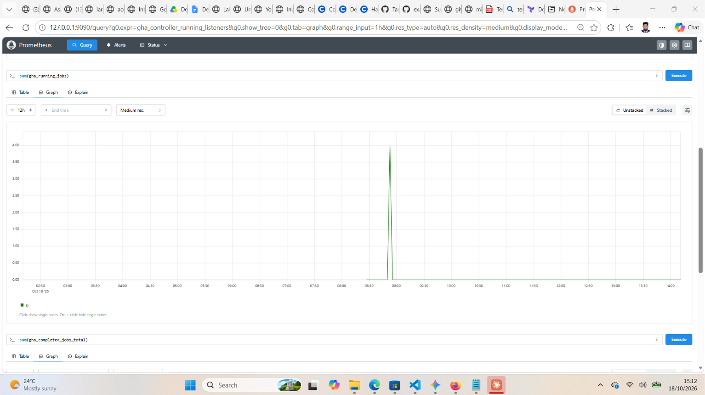
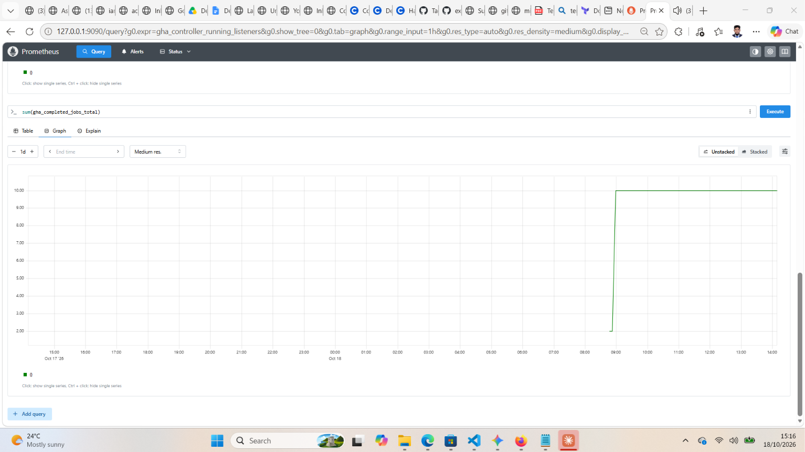

# ⚡ Scalable CI/CD Infrastructure: Auto-Scaling GitHub Actions Runners on AKS (ARC)

[](https://azure.microsoft.com/)
[](https://www.terraform.io/)
[](https://kubernetes.io/)
[](https://helm.sh/)
[](https://prometheus.io/)

A production-ready, self-hosted GitHub Actions compute platform engineered on Azure Kubernetes Service (AKS) using Actions Runner Controller (ARC). This implementation replaces expensive, always-on 24/7 static VMs with demand-driven, single-use ephemeral runner pods that automatically scale down to zero when idle—eliminating developer CI build queues while drastically reducing cloud compute expenditure.

---

## 🎯 The Engineering Challenge

In enterprise CI/CD environments, engineering teams frequently face two conflicting operational hurdles:

* **Developer Bottlenecks & Pipeline Queues:** Traditional static self-hosted virtual machines have fixed concurrency limits. When multiple developers push code or trigger jobs simultaneously, workflows sit in long queues waiting for an available runner.
* **Cloud Budget Waste:** To eliminate queues, teams often over-provision static VMs, paying for compute, storage, and licensing 24/7—even when systems sit completely idle overnight and on weekends.
* **Security & State Contamination:** Persistent VMs reuse disk volumes across runs, increasing security risks from residual credentials, untracked build artifacts, and configuration drift.

---

## 💡 The Architectural Solution

This platform addresses those trade-offs through Kubernetes-native event-driven automation:

* **Ephemeral Pod Lifecycle:** Every runner pod is assigned a single-use Just-in-Time (JIT) token from GitHub. It provisions, processes exactly one job, and terminates immediately.
* **Outbound Event Listening (Zero Ingress):** The ARC listener pod establishes an outbound HTTPS long-poll connection to GitHub's message broker. No public IPs, ingress controllers, or inbound firewall exceptions are required.
* **0-to-N Autoscaling:** Configured `minRunners: 0` to `maxRunners: 10`. If zero pipelines are queued, the active runner count is 0. When traffic surges, pods spin up dynamically across node pools.
* **Docker-in-Docker (DinD):** Encapsulated Docker daemons run alongside runner containers to support containerized image builds securely inside Kubernetes.
* **Cross-Namespace Telemetry:** Integrated Prometheus metrics scraping across cluster namespaces to track runner fleet utilization, queue latency, and job completions in real time.

---

## 🏗️ Architecture & Execution Flow

```
                      +-----------------------------+
                      |   Developer Push / PR / CI  |
                      +-----------------------------+
                                     │
                                     ▼
                      +-----------------------------+
                      | GitHub Actions Job Queue    |
                      +-----------------------------+
                                     ▲
               Outbound HTTPS        │  Job Available Signal
                 Long-Poll           ▼
       +─────────────────────────────────────────────────────────────+
       │ Azure Kubernetes Service (AKS) Cluster                      │
       │                                                             │
       │   +─────────────────────────────+                           │
       │   | ARC Listener Pod            |                           │
       │   | (Namespace: arc-systems)    |                           │
       │   +─────────────────────────────+                           │
       │                  │                                          │
       │                  │ Scale Request / Desired Replicas         │
       │                  ▼                                          │
       │   +─────────────────────────────+                           │
       │   | ARC Controller Manager      |                           │
       │   | (Namespace: arc-systems)    |                           │
       │   +─────────────────────────────+                           │
       │                  │                                          │
       │                  │ Spawns Dynamic Ephemeral Pods            │
       │                  ▼                                          │
       │   +───────────────────────────────────────────────────────+ │
       │   │ Namespace: arc-runners                                │ │
       │   │                                                       │ │
       │   │  [ Runner Pod 1 ]   [ Runner Pod 2 ] ... [ Pod N ]    │ │
       │   │  (Runs 1 Job)       (Runs 1 Job)         (Runs 1 Job) │ │
       │   │         │                  │                    │     │ │
       │   │         ▼                  ▼                    ▼     │ │
       │   │     Terminated         Terminated           Terminated│ │
       │   +───────────────────────────────────────────────────────+ │
       │                                                             │
       │   +─────────────────────────────+                           │
       │   | Prometheus Operator         |                           │
       │   | (Namespace: monitoring)     |                           │
       │   +─────────────────────────────+                           │
       │                  │ Scrapes Ports 8080                       │
       │                  ▼                                          │
       │         [ Metrics & Dashboards ]                            │
       +─────────────────────────────────────────────────────────────+
```

---

## 📊 Empirical Verification & Load Testing

### 1. Concurrency Burst Under Parallel Load
To validate horizontal autoscaling under peak traffic, a GitHub Actions matrix workflow was dispatched with multiple concurrent worker jobs. The platform detected the queue demand, provisioned parallel runner pods up to capacity, completed all tasks, and cleanly terminated the entire fleet back to zero:


*Figure 1: Real-time Prometheus telemetry tracking `sum(gha_running_jobs)` spiking to 8 concurrent ephemeral pods during parallel workflow execution and returning to zero.*

### 2. Job Throughput & Completion Telemetry

*Figure 2: Prometheus monotonic counter `sum(gha_completed_jobs_total)` recording total workflow executions completed.*

---

## 📁 Repository Layout

```text
aks-arc-autoscaling-runners/
├── .github/
│   └── workflows/
│       └── arc-test.yml              # Load testing & verification matrix pipeline
├── terraform/
│   ├── backend.tf                    # Azure Blob Storage remote state configuration
│   ├── local.tf                      # Resource naming & tags
│   ├── main.tf                       # AKS cluster, node pools, and resource group
│   ├── variables.tf                  # Input parameters and cluster configurations
│   ├── output.tf                     # Credentials, kubeconfig context, and cluster outputs
│   └── terraform.tfvars.example      # Example parameter file (no secrets)
├── helm/
│   └── arc-values.yaml               # AutoScalingRunnerSet Helm values (min/max, DinD, metrics)
├── monitoring/
│   ├── metrics-services.yaml         # Internal ClusterIP services for metrics exposure
│   └── prometheus-extra-scrape.yaml  # Cross-namespace Prometheus scrape job overrides
├── docs/
│   ├── assets/                       # Telemetry graphs and architectural diagrams
│   └── troubleshooting-playbook.md   # Production SOP, error resolution, and runbook
├── .gitignore                        # Prevents state, secrets, and plan leaks
└── README.md                         # Project documentation and engineering summary
```

---

## 🚀 Quickstart & Deployment Guide

### Prerequisites
* **Azure CLI (`az`)**: Authenticated with `Contributor` role on the target subscription.
* **Terraform CLI**: `>= 1.5.0`
* **Kubernetes CLI (`kubectl`)** & **Helm CLI**: `>= 3.8.0`
* **GitHub Personal Access Token (Classic)**: Scoped with `repo` (repository runner) or `admin:org` (organization runner).

### 1. Provision Infrastructure via Terraform
```bash
# Navigate to Terraform module
cd terraform

# Initialize providers and remote backend
terraform init

# Generate deterministic execution plan
terraform plan -out=aks_runner.plan

# Apply the infrastructure
terraform apply aks_runner.plan

# Retrieve AKS credentials
az aks get-credentials --resource-group rg-arc-runners --name arc-runner-cluster
```

### 2. Deploy Actions Runner Controller (ARC) Operator
```bash
# Export GitHub PAT to shell session (never commit credentials to disk)
export GITHUB_TOKEN="ghp_YourGitHubTokenHere"

# Install ARC Controller Manager with metrics enabled
helm install arc \
  oci://ghcr.io/actions/actions-runner-controller-charts/gha-runner-scale-set-controller \
  --namespace arc-systems \
  --create-namespace \
  --set metrics.controllerManagerAddr=":8080"
```

### 3. Deploy Runner ScaleSet
```bash
# Install the Runner ScaleSet using custom Helm values
helm install my-runners \
  oci://ghcr.io/actions/actions-runner-controller-charts/gha-runner-scale-set \
  --namespace arc-runners \
  --create-namespace \
  -f ../helm/arc-values.yaml \
  --set githubConfigSecret.github_token="$GITHUB_TOKEN"
```

### 4. Configure Prometheus Telemetry
```bash
# Apply metrics services in arc-systems
kubectl apply -f ../monitoring/metrics-services.yaml

# Deploy Prometheus Community Chart with custom scrape config
helm repo add prometheus-community https://prometheus-community.github.io/helm-charts
helm repo update

helm install prometheus prometheus-community/prometheus \
  --namespace monitoring \
  --create-namespace \
  -f ../monitoring/prometheus-extra-scrape.yaml

# Port-forward Prometheus UI locally
kubectl port-forward svc/prometheus-server -n monitoring 9090:80
```

---

## 🧪 Declaring Runners in Your Workflows

To route any CI/CD pipeline job to this auto-scaling fleet, set `runs-on` to the scale set name defined in `arc-values.yaml` (`aks-autoscaler-fleet`):

```yaml
name: Production CI Suite

on:
  push:
    branches: [ "main" ]
  pull_request:
    branches: [ "main" ]

jobs:
  test-and-build:
    runs-on: aks-autoscaler-fleet
    steps:
      - name: Checkout Code
        uses: actions/checkout@v4

      - name: Verify Isolated Runner
        run: |
          echo "Running on ephemeral AKS pod: $(hostname)"
          docker --version

      - name: Run Build Steps
        run: |
          npm ci
          npm test
```

---

## 📈 Key PromQL Monitoring Queries

| Metric / Expression | Description & Target Threshold |
| :--- | :--- |
| `sum(gha_running_jobs)` | Current executing workflow jobs across pods (spikes during load, drops to 0). |
| `sum(gha_completed_jobs_total)` | Monotonic counter tracking all completed workflow executions. |
| `gha_controller_running_listeners` | Active listener heartbeat (`1.00` indicates a healthy long-poll connection to GitHub). |
| `sum(gha_busy_runners) / sum(gha_registered_runners) * 100` | Runner utilization rate (optimal peak target: 70%–80%). |

---

## 🧹 Resource Teardown

To release all compute resources and avoid ongoing Azure charges:

```bash
# 1. Uninstall Helm deployments
helm uninstall my-runners -n arc-runners
helm uninstall arc -n arc-systems
helm uninstall prometheus -n monitoring

# 2. Destroy cloud infrastructure with Terraform
cd terraform
terraform destroy -auto-approve
```

---

## 👤 Author & Maintainer

* **Asadul Howlader**
* **GitHub:** [@AsadulCloud](https://github.com/AsadulCloud)
* **LinkedIn:** [Asadul Howlader](https://linkedin.com/in/)